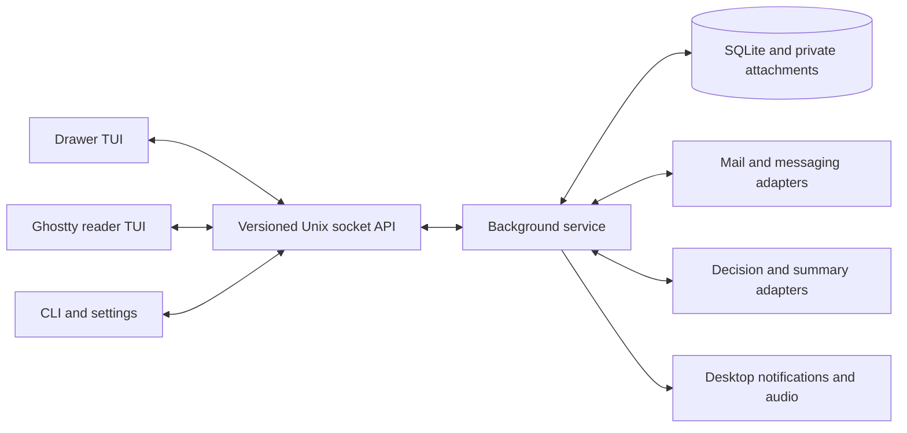

# d-hub technical architecture

Use Rust with Ratatui and Crossterm for the TUI, SQLite for persistent local state, and an asynchronous background service for provider work. The architecture separates deterministic interaction state from remote integrations so the first prototype can run entirely offline.

## Process model

One service owns provider sessions, sync cursors, database writes, outbox operations and alerts. TUI windows subscribe to sequenced events and request commands. The service works without a window; later supply an optional systemd user unit, enabled through an explicit setup action.

An optional QML Omarchy companion plugin is another client of the same versioned local API, directly or through a narrow typed CLI bridge. It displays unread/connection status, activates the Ghostty drawer and requests focus-profile changes. It does not own provider sessions, database writes, drafts, sends or alerts. The Rust service runs outside the Quickshell process so plugin reload/disable and shell restart do not terminate communications work. Reconnection obtains a fresh snapshot before showing current status; disconnected or stale status is explicit.

Use a user-private Unix socket under XDG_RUNTIME_DIR with permission and peer-identity checks, protocol version negotiation, bounded payloads and structured errors. Start with JSON messages if that keeps debugging simple. On disconnect, reconnect and request a consistent snapshot plus subsequent events rather than assuming no events were missed. Prevent concurrent daemon start with an exclusive lock. Migrate the database before accepting clients.

## Implemented shared service · 18 October 2026

`database`, `service` and `ipc` implement an explicit `daemon --demo --foreground` owner, one editable drawer and read-only readers. `--demo` runs no network/credential workers. `--live` starts daemon-owned per-account provider workers and optional AI decisions. The standalone notification bridge remains a separate read-only mode.

SQLite schema 2 stores transactional domain snapshots/settings, a durable outbox, 256 revision/change records, the immutable live/demo mode and normalized remote records keyed by provider identity plus account configuration scope. Remote local state survives feed eviction; import markers commit with snapshots so an interrupted allocation remains replayable. Bootstrap imports legacy demo JSON once, retains the original file and rejects malformed/future/foreign schemas. WAL/FULL synchronization and transaction boundaries keep draft and outbox state consistent. This is a staged migration toward the normalized provider records below, not the final provider database layout. Mail MIME/HTML text conversion is implemented; private attachment bytes remain pending.

The owner serializes typed action batches with expected global revisions and composer-state checks. A connection-scoped drawer lease prevents two editors; disconnect releases it. Explicit save-and-switch parks a draft keyed by provider/account/conversation/**incoming message**/reply mode, then restores the selected message’s draft. Old saved keys normalize from the immutable target. Reader actions only mark the requested message seen under policy. Settings edits use the same typed schema from the drawer and `config --socket`, while standalone TOML is initialization/export for the service.

Protocol 2 excludes older demo-only clients from live sessions. Explicit unsent recovery accepts protocol 1 with existing target/conflict checks. Unix RPC verifies same-user credentials and private socket ownership, rejects unsupported protocol versions and limits frames to 8 MiB, service snapshots to 4 MiB, connections to 16, the owner queue to 64 and action batches to 256. One bounded client worker keeps socket waits off the render loop. Clients poll revisions and receive a current snapshot plus retained change metadata; gaps request full resync. This is snapshot synchronization, not arbitrary delta replay. Concurrent stale composer/settings edits are rejected; local optimistic edits replay only against matching context, otherwise the client freezes and preserves recovery state.

Mock submissions commit before the owner starts its completion timer; closing a window cannot duplicate/cancel them. A process restart converts submitting to uncertain and does not retry. Disconnected editor text and pending intent persist privately; explicit recovery restores unsent drafts with conflict/target checks and never restores send operations. Live sends also commit before execution; background workers return acceptance/failure/uncertainty without recipient authority. Account/resource changes invalidate cursor/draft/read authority. Queue sizes and the recent 200-item feed bound active state; provider records remain private on disk. Automatic reconnect, richer retention/history and actual desktop acceptance remain next work.

## Suggested code organisation

Start with one Cargo package and focused modules; split into workspace crates only when it improves boundaries. Suggested modules: domain, composer, storage, service, ipc, providers, ai, notifications, clipboard, config, commands, theme, tui and launch. Keep companion QML/manifest sources under `integrations/omarchy/`, separate from Rust modules. Avoid a large provider plugin framework before two concrete providers prove the interface; the Omarchy companion uses the desktop's existing plugin mechanism.

Select compatible current versions of Ratatui, Crossterm, ratatui-image, an async runtime, clap, serde/TOML and SQLite bindings. Record the choice in Cargo.lock. Do not freeze version guesses from this planning document. Implement image resizing and encoding off the render thread. Use dirty-state redraws and terminal synchronized output where supported.

## Domain records

| Record | Essential data |
| --- | --- |
| Account | Stable local ID, provider, display identity, secret reference, capabilities, enabled state |
| Conversation | Account ID, remote ID, participants, subject/channel, latest incoming time |
| Message | Local ID, provider ID, conversation, sender/recipients, provider time, observed time, body refs, direction, unread state, revision |
| Attachment | Message/draft association, MIME, safe filename, size, private local blob/ref, download/upload state |
| Draft | Immutable target snapshot, body, attachment refs, revision, editor lease, saved time, lock state |
| OutboxOperation | Operation UUID, draft revision, target, payload hash, status, provider reference, reconciliation state |
| SyncCursor | Account/resource cursor, last success, backfill boundary, retry state |
| Classification | Message/conversation revision, focus version, provider/model/questions version, typed answers, timestamps |
| Summary | Conversation revision, provider/model/prompt version, generated text, stale flag |
| AlertLedger | Event identity, policy version, popup/sound outcomes and grouping reference |

Use uniqueness constraints for provider identity and sync idempotence. Store UTC timestamps; do not sort by local strings. Separate server unread flags from local seen, dismissed and snoozed state. Keep normalized provider capabilities, e.g. read, reply, mark-read, upload, server-unread, history, rather than scattered provider name checks.

## Sending and persistence

Persist an outbox operation before network submission and bind it to a draft revision. Freeze editing of the submitted revision or explicitly fork a new draft. Double keypresses share the same operation. Provider acceptance is not a delivery receipt. Model queued, uploading, submitting, accepted, failed and uncertain states honestly.

A network timeout after submitting is not proof of failure. Use a provider's idempotency or lookup mechanism if available; otherwise surface uncertainty and require an intentional retry. Never automatically resend non-idempotent operations after restart. IMAP SMTP sending and saving a Sent copy are separate operations and must not duplicate each other.

Draft body and attachment associations should be transactionally consistent. Stage copied attachment bytes first, atomically attach the completed blob, and garbage-collect unreferenced staged content later. Persist after edits with bounded debounce and flush on focus transitions/exit where possible; test crash recovery. Default user-private state/cache permissions. Encryption at rest is a later explicit design choice, not a claim implied by file permissions.

## Synchronisation and AI

Each adapter runs independent bounded tasks with backoff, jitter, rate-limit handling and cancellation. No slow account blocks the other sources. Use provider incremental sync mechanisms when available, with polling fallback appropriate to API limits. Backfill is distinguishable from a live arrival and cannot trigger an alert storm.

AI jobs are asynchronous and cached by content/focus/question revision. Ignore stale completions. Decision failures leave deterministic rules usable. Do not assume probability fields have identical calibration across providers. Summary generation is separate from typed decisions. Message content is input data, never authority to invoke commands, alter settings or send replies.

## Desktop integration

Clipboard access uses Wayland MIME data, not only terminal paste events. Keep the clipboard owner/provider alive when exporting file URIs. Use explicit subprocess argv or native bindings for external helpers; never interpolate message text, filenames or notification arguments into a shell command.

Use the freedesktop notification D-Bus API with stable app identity and default click action. Add a narrow Omarchy adapter for DND and desktop behaviour. Play audio through an appropriate available audio facility and enforce the same suppression policy before playback. Do not use terminal BEL as the default alert sound.

The companion plugin controls the existing Ghostty TUI rather than rendering the communications feed or composer in QML. Route drawer activation through one launch/focus path shared with notification actions. Activation alone never selects a different reply target. Keep Omarchy theme, DND and window compatibility inside the desktop adapter, with conservative fallback when unavailable. The standalone application and offline demo must not require the plugin or a running Omarchy shell.

## Verification strategy

Unit-test the pure composer reducer and focus predicate. Integration-test database migrations, outbox recovery, draft leases, event replay, clipboard fixtures and provider translation contracts. Use fake services for failures and pagination. Smoke-test actual Ghostty rendering, focus, keyboard sequences, Wayland clipboard, reader spawning and Omarchy alerts on the owner desktop. A remote headless development box cannot establish those desktop behaviours by itself.

## On-demand startup and explicit personal QR setup

Default interactive launch starts/reuses the per-user live owner through a typed subprocess argument list, startup ownership lock, private bounded startup diagnostics and readiness check. The child has a separate process group and detached standard streams; closing the drawer does not stop it. Explicit sockets and --no-start-service are connect-only. Noninteractive callers do not create a hidden daemon. This is process startup, not systemd/desktop installation.

QR authentication is a separate explicit setup job with one per-account runtime lock, ephemeral private key, bounded event channel, mobile approval, verified identity and a local commit step. Secrets never pass through IPC or persistent domain snapshots. The UI/CLI persists the verified user ID through the existing settings contract after successful keyring storage; its personal credential namespace is separate from bot/mail references. An additive snapshot capability prevents storing new identity metadata through older daemons. QR setup does not add a second message/sync/send owner or claim a DM transport exists.

## Production releases and handover

`update` is an independent, bounded background worker for the fixed stable GitHub channel. Only user-owned marked installs are replaced; atomic staged rename retains the previous executable. `auto_update` shares the typed settings registry. The owner checks at startup/six-hour intervals and on drawer attachment; :update/CLI request manual checks. Idle IPC replies carry compact update metadata rather than resending the feed.

A staged binary causes frontends to flush and acknowledge a pause. The owner waits for all drawer/reader acknowledgements (or disconnects) and no active/queued send before dropping database/socket locks and execing the installed executable. Updated frontends restore terminal modes before exec; a schema-independent build-info probe is accepted before normal protocol negotiation, so the old frontend does not need to decode the new snapshot. Preserve that probe across future IPC versions. Mutations are never replayed across update disconnects. Demo and unmarked source/package executables never auto-replace. Failed-start rollback supervision remains outside this slice; see UPDATES.md.
